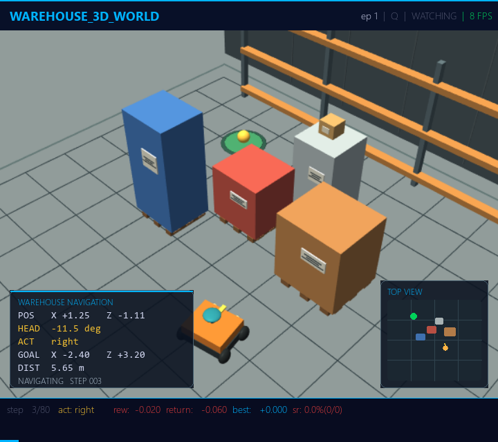

# Warehouse 3D Rendering

`warehouse_3d_world` uses Panda3D for its interactive RGB preview when the
optional renderer is available. Panda3D renders into an offscreen buffer; the
pygame viewer draws that frame and its navigation HUD. The simulation state,
observations, rewards, and actions remain local to the verse.



Install the viewer dependencies, including Panda3D:

```powershell
python -m pip install -r requirements_ui.txt
```

Start the warehouse viewer:

```powershell
python tools/watch.py --frontend pygame --verse warehouse_3d_world --algo q
```

The default `render_backend=auto` uses Panda3D if it can open an offscreen
graphics buffer, and otherwise falls back to the built-in software rasterizer.
Choose a backend explicitly with `--vparam`:

```powershell
python tools/watch.py --frontend pygame --verse warehouse_3d_world --algo q --vparam render_backend=panda3d
python tools/watch.py --frontend pygame --verse warehouse_3d_world --algo q --vparam render_backend=software
```

The default camera is isometric so the robot, obstacles, and goal stay in view.
Switch to a closer follow camera when you want to focus on driving:

```powershell
python tools/watch.py --frontend pygame --verse warehouse_3d_world --algo q --vparam camera_mode=follow
```

Regenerate the scene and viewer previews after visual changes:

```powershell
python tools/render_3d_snapshot.py
python tools/render_warehouse_viewer_preview.py
```

The Panda3D path adds multisample smoothing, per-pixel lighting, a cleaner robot
model, warehouse shelving, palletized cartons, and a target marker. The software
backend remains available for headless runs and machines without a graphics
context.
